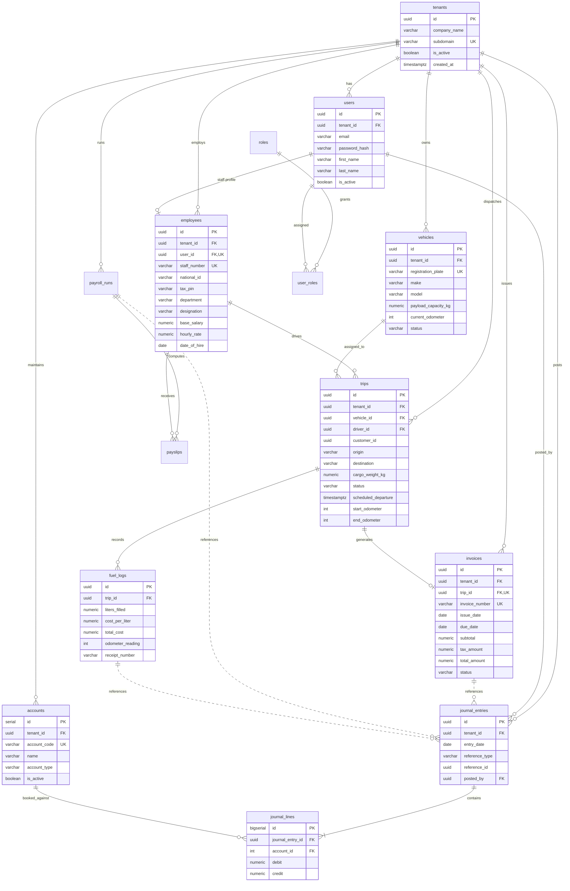

# Database Design & Relational Data Model

## Apex Logistics & Supply Chain Ltd
**Engine:** PostgreSQL 16  
**Source DDL File:** [`schema.sql`](file:///home/danitech/Desktop/Projects/Apex%20Logistics%20&%20Supply%20Chain%20Ltd/schema.sql)

---

## 1. Entity-Relationship Diagram (ERD)

---

## 2. Schema Breakdown & Architectural Intent

### 1. `auth_core` Schema
- **Tenancy Isolation:** `tenants` table acts as the multi-tenant root. Every domain table references `tenant_id` with `ON DELETE RESTRICT` to prevent accidental cascading data wipes.
- **Identity & RBAC:**
  - `users`: Email unique per tenant (`uq_tenant_user_email`).
  - `roles`: Canonical role codes (`SUPER_ADMIN`, `HR_OFFICER`, `ACCOUNTANT`, `DISPATCHER`, `DRIVER`).
  - `user_roles`: Many-to-many junction table assigning users one or more granular roles.

### 2. `hr_payroll` Schema
- **Employee Master:** `employees` links 1-to-1 with `users` (`user_id UNIQUE`). Holds statutory compliance fields (KRA Tax PIN, National ID) and compensation structures (`base_salary`, `hourly_rate`).
- **Payroll Processing:**
  - `payroll_runs`: Batch runs (`DRAFT` ➔ `APPROVED` ➔ `DISBURSED`) capturing overall gross/net liabilities.
  - `payslips`: Individual employee slips capturing `base_pay`, calculated `allowances` (e.g., driver mileage/per-diem), `deductions_tax` (PAYE), and `deductions_statutory` (SHA/NHIF, NSSF, Housing Levy).

### 3. `fleet_ops` Schema
- **Vehicle Registry:** `vehicles` tracks commercial fleet assets, payload capacities, live odometers, and operational statuses (`AVAILABLE`, `IN_TRANSIT`, `MAINTENANCE`).
- **Trip Lifecycle:** `trips` models dispatch execution linking a vehicle asset, driver (`employees.id`), and customer. Stores scheduled vs. actual departures, origin, destination, cargo specs, and odometer delta (`start_odometer`, `end_odometer`).
- **Fuel Tracking:** `fuel_logs` records liters, rates, total cost, pump receipts, and odometer readings tied directly to specific trips.

### 4. `finance` Schema
- **General Ledger Engine:**
  - `accounts`: Chart of Accounts categorized by standard accounting types (`ASSET`, `LIABILITY`, `EQUITY`, `REVENUE`, `EXPENSE`).
  - `journal_entries`: Audit-compliant transaction headers with polymorphic references (`reference_type` = `TRIP_INVOICE`, `PAYROLL_RUN`, `FUEL_EXPENSE`).
  - `journal_lines`: Double-entry transaction lines enforcing strict database-level checks:
    - `chk_positive_lines`: `debit >= 0 AND credit >= 0`
    - `chk_mutually_exclusive`: A line must be strictly debit OR credit, never both or neither.
- **Invoicing:** `invoices` links directly to `fleet_ops.trips` via a 1-to-1 unique constraint (`trip_id UUID UNIQUE`), ensuring every trip can have at most one official tax invoice.

---

## 3. Cross-Domain Integrity & Workflows

1. **Trip-to-Invoice Generation:**
   - Once a trip reaches `COMPLETED` state, an invoice is inserted into `finance.invoices` referencing `trip_id`.
   - A `journal_entry` is posted with two `journal_lines`:
     - **Debit:** Accounts Receivable (Asset)
     - **Credit:** Freight Revenue (Revenue)
2. **Trip-to-Payroll Driver Allowance:**
   - On trip completion, calculated distance (`end_odometer - start_odometer`) multiplies by driver rate to generate an allowance entry ready for the next `hr_payroll.payroll_runs`.
3. **Fuel Expense Booking:**
   - `fuel_logs` creates an Accounts Payable or Cash expense:
     - **Debit:** Vehicle Running Fuel Expense
     - **Credit:** Fuel Supplier AP / Cash Account

---

## 4. Indexing & Query Optimization Strategy

| Index Name | Table | Columns | Purpose |
| :--- | :--- | :--- | :--- |
| `idx_users_tenant_email` | `auth_core.users` | `(tenant_id, email)` | High-throughput tenant-scoped authentication lookups |
| `idx_employees_tenant_user` | `hr_payroll.employees` | `(tenant_id, user_id)` | Fast staff profile retrieval during ESS logins |
| `idx_trips_driver_status` | `fleet_ops.trips` | `(driver_id, status)` | Driver fatigue check: finding active/in-transit trips |
| `idx_trips_vehicle_status` | `fleet_ops.trips` | `(vehicle_id, status)` | Fleet availability check: verifying vehicle dispatch readiness |
| `idx_journal_lines_entry` | `finance.journal_lines` | `(journal_entry_id)` | O(1) balance validation and ledger statement queries |
| `idx_journal_entries_ref` | `finance.journal_entries` | `(reference_type, reference_id)` | Fast audit trail lookups for invoices, trips, and payroll |
