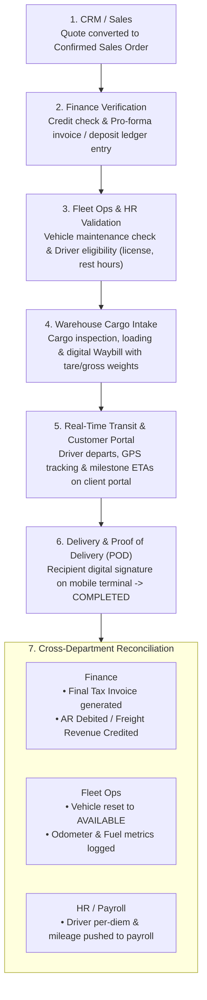

# End-to-End Operational Lifecycle Workflow

## Apex Logistics & Supply Chain Ltd

This document defines the standard operational lifecycle of a freight and logistics job, from initial customer engagement to automated post-delivery cross-department reconciliation.

---

## 1. Visual Workflow Diagram

---

## 2. Stage-by-Stage Operational Lifecycle

### Stage 1: CRM & Sales (Order Inception)
- **Action:** Corporate customer contract finalized; quote converted into confirmed Sales Order.
- **Key Data:** Client ID, Route origin & destination, Cargo classification (ambient, weight, volume), agreed rate tariffs, fuel surcharges, billing terms.
- **System Trigger:** Sales Order status moves from `DRAFT / QUOTED` to `ORDER_CONFIRMED`.

### Stage 2: Finance Verification (Risk & Liquidity Check)
- **Action:** Credit limit automatically checked against customer ledger; pro-forma invoice and deposit ledger entry created.
- **Validations:**
  - Automated check on client's outstanding AR balance + order value vs. approved credit limit.
  - Advance deposit verification if required by credit terms.
- **State Transition:** Sales Order moves to `FINANCE_APPROVED`.

### Stage 3: Fleet Operations & HR Validation (Asset & Crew Allocation)
- **Action:** Trip scheduled; vehicle assigned based on maintenance status; driver assigned based on active license & rest hours.
- **Validations:**
  - **Fleet Ops Check:** Vehicle status must be `AVAILABLE` (no pending scheduled maintenance, no active defect reports, valid inspection stickers).
  - **HR / Driver Check:** Driver driving license valid; mandatory rest hours met (driver fatigue compliance); zero overlapping active trip assignments.
- **State Transition:** Trip created with status `TRIP_SCHEDULED`.

### Stage 4: Warehouse Cargo Intake (Loading & Manifesting)
- **Action:** Cargo inspected and loaded at warehouse/dock; digital Waybill generated with verified tare/gross weights.
- **Validations:**
  - Inspection against packing list / manifest.
  - Weighbridge tare & gross weight verification to prevent weighbridge penalties during transit.
- **State Transition:** Digital Waybill generated; Trip status moves to `DISPATCH_READY`.

### Stage 5: Real-Time Transit & Customer Portal (Execution & Visibility)
- **Action:** Driver departs; customer tracks transit milestones and delivery ETA via client self-service portal.
- **Operational Data:** Telematics / GPS ping updates, corridor checkpoints, ETA updates, exception alerts (delays, rerouting).
- **State Transition:** Trip status moves to `IN_TRANSIT`.

### Stage 6: Delivery & Proof of Delivery (POD) (Fulfillment)
- **Action:** Receiving dock signs digital POD on mobile terminal; trip state marked as `COMPLETED`.
- **Artifacts Captured:** Digital recipient signature, timestamp, GPS coordinates at drop-off, cargo condition photos/exceptions.
- **State Transition:** Waybill & Trip status move to `DELIVERED` / `COMPLETED`.

### Stage 7: Automatic Cross-Department Reconciliation (Settlement)
Triggered immediately upon POD confirmation:

1. **Finance & Accounting:**
   - Final Tax Invoice automatically generated with KRA / statutory compliance.
   - General Ledger update: Accounts Receivable (AR) debited; Freight Revenue credited.
   - Reconciles trip fuel advances/receipts against supplier fuel accounts.
2. **Fleet Operations & Maintenance:**
   - Vehicle status reset to `AVAILABLE`.
   - Trip distance logged; vehicle odometer and telematics fuel consumption counters updated.
   - Triggers preventative maintenance alert if odometer hits service milestone.
3. **Human Resources & Payroll:**
   - Driver trip per-diem and mileage allowance automatically computed.
   - Allowance figures pushed directly to the driver's upcoming payroll cycle (eliminating paper clipboards).

---

## 3. Order & Trip Lifecycle State Machine

| Entity | States |
| :--- | :--- |
| **Sales Order** | `DRAFT` ➔ `QUOTED` ➔ `ORDER_CONFIRMED` ➔ `FINANCE_APPROVED` ➔ `FULFILLING` ➔ `INVOICED` ➔ `CLOSED` |
| **Trip** | `PLANNED` ➔ `TRIP_SCHEDULED` ➔ `DISPATCH_READY` ➔ `IN_TRANSIT` ➔ `ARRIVED_AT_DESTINATION` ➔ `COMPLETED` ➔ `RECONCILED` |
| **Truck Asset** | `AVAILABLE` ➔ `ASSIGNED` ➔ `IN_TRANSIT` ➔ `UNDER_INSPECTION` ➔ `MAINTENANCE_DUE` ➔ `IN_SHOP` |
| **Driver** | `OFF_DUTY` ➔ `ASSIGNED` ➔ `DRIVING` ➔ `ON_REST` ➔ `AVAILABLE` |
