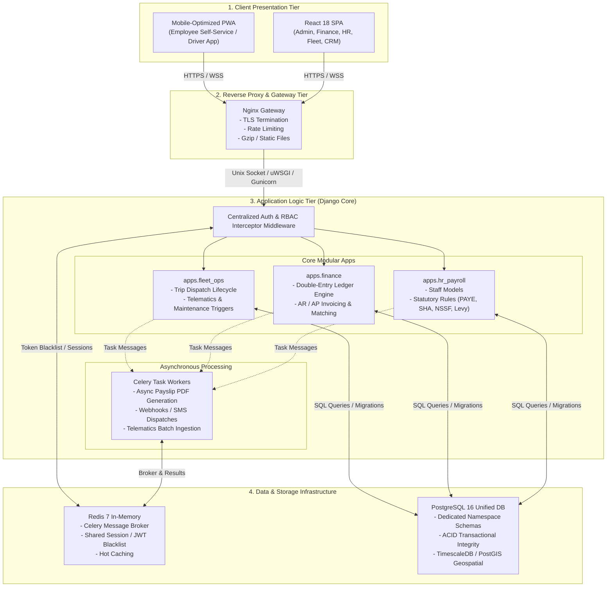

# System Architecture & Technical Infrastructure

## Apex Logistics & Supply Chain Ltd

This document defines the high-level system architecture, technology stack, service tiers, and infrastructure design for the Apex Logistics enterprise management platform.

---

## 1. System Architecture Diagram

### ASCII Overview
```
+---------------------------------------------------------------------------------------+
|                                CLIENT PRESENTATION TIER                                |
|                                                                                       |
|   +---------------------------------------+   +-----------------------------------+   |
|   |         React 18 Single Page App      |   |       Mobile-Optimized PWA        |   |
|   |     (Admin, Finance, HR, Fleet, CRM)  |   |    (Employee Self-Service / Driver) | |
|   +---------------------------------------+   +-----------------------------------+   |
+---------------------------------------------------------------------------------------+
                                           │
                                     HTTPS / WSS
                                           │
+---------------------------------------------------------------------------------------+
|                        REVERSE PROXY & GATEWAY TIER (Nginx)                           |
|   - TLS Termination     - Rate Limiting     - Gzip Compression     - Static Files     |
+---------------------------------------------------------------------------------------+
                                           │
                                  UNIX Socket / Reverse Proxy
                                           │
+---------------------------------------------------------------------------------------+
|                          APPLICATION LOGIC TIER (Django Core)                         |
|                                                                                       |
|   +-------------------------------------------------------------------------------+   |
|   |                   Centralized Auth & RBAC Interceptor Middleware              |   |
|   +-------------------------------------------------------------------------------+   |
|                                           │                                           |
|   +---------------------+  +----------------------+  +----------------------------+   |
|   |   apps.hr_payroll   |  |     apps.finance     |  |       apps.fleet_ops       |   |
|   |  - Staff Models     |  |  - Ledger Engine     |  |  - Trip Dispatch Lifecycle |   |
|   |  - Statutory Rules  |  |  - AR/AP Processing  |  |  - Maintenance Triggers    |   |
|   +---------------------+  +----------------------+  +----------------------------+   |
|              │                        │                             │                 |
|              └────────────────────────┼─────────────────────────────┘                 |
|                                       │ Event Messages                                |
|                                       ▼                                               |
|                           [ Celery Task Workers ]                                     |
|                           - Asynchronous Payslip PDF Generation                       |
|                           - Notification Webhooks / SMS Dispatches                    |
+---------------------------------------------------------------------------------------+
                                           │
                               TCP Network Connections
                                           │
+---------------------------------------------------------------------------------------+
|                              DATA & STORAGE INFRASTRUCTURE                            |
|                                                                                       |
|   +-----------------------------------+    +--------------------------------------+   |
|   |          Redis 7 In-Memory        |    |      PostgreSQL 16 (Unified DB)       |   |
|   |  - Celery Broker & Result Backend |    |  - Dedicated Namespace Schemas       |   |
|   |  - Shared Cache & Auth Blacklists |    |  - ACID Transactional Integrity      |   |
|   +-----------------------------------+    +--------------------------------------+   |
+---------------------------------------------------------------------------------------+
```

### Visual Mermaid Architecture


---

## 2. Tier Breakdown & Technical Specifications

### Tier 1: Client Presentation Tier
1. **React 18 Single Page Application (SPA):**
   - **Target Audience:** Headquarter and regional office staff (Executive, Finance, HR, Fleet Managers, Dispatchers, CRM Sales).
   - **Key Features:** Rich data tables, real-time dispatch dashboard, double-entry financial reconciliation screens, interactive fleet maps.
   - **State & Data Management:** React Query / TanStack Query, Redux Toolkit / Zustand, Tailwind CSS / Shadcn UI.

2. **Mobile-Optimized Progressive Web App (PWA):**
   - **Target Audience:** 350 Employees across depots (Drivers, mechanics, dock warehouse workers).
   - **Key Features:**
     - **Driver View:** Digital Trip Sheet, GPS ping beacon, electronic Proof of Delivery (e-POD) with signature capture, incident reporting.
     - **Employee Self-Service (ESS):** Mobile payslip download, leave request submissions, trip per-diem and mileage expense submission.
   - **Offline Capability:** Service Workers for offline trip tracking and receipt image queueing.

---

### Tier 2: Reverse Proxy & Gateway Tier (Nginx)
- **TLS Termination:** Modern SSL/TLS encryption (HTTPS / WSS).
- **Traffic Routing:** Directs REST API and WebSocket connections to Django / ASGI / WSGI servers; serves optimized frontend static assets.
- **DDoS & Rate Limiting:** Rate limiting on authentication and public tracking endpoints.
- **Security Headers:** Strict CORS policies, CSP, HSTS, and XSS protection.

---

### Tier 3: Application Logic Tier (Django Core)
- **Framework:** Python / Django (Django REST Framework + Django Channels for WebSockets).
- **Security & RBAC Middleware:**
  - Centralized interceptor enforcing Role-Based Access Control (RBAC).
  - Fine-grained permission model (Role-Permission mappings across Departments: HR, Finance, Fleet, Warehouse, Sales).
- **Modular Applications:**
  - `apps.hr_payroll`: Staff lifecycle, attendance, overtime/allowance compute, statutory tax calculations (PAYE, SHA/NHIF, NSSF, Housing Levy).
  - `apps.finance`: General ledger, chart of accounts, AR/AP, automatic trip invoice generation, fuel ledger reconciliation.
  - `apps.fleet_ops`: Vehicle registry, driver assignments, trip dispatch lifecycle, telematics ingestion, preventative maintenance odometer alarms.
- **Celery Task Workers:**
  - Asynchronous background execution to keep API response times < 200ms.
  - PDF generation (payslips, invoices, waybills).
  - SMS & email dispatch via regional gateways (e.g., Africa's Talking / Twilio).
  - Periodic Celery Beat schedules (e.g., daily maintenance checks, nightly ledger balances).

---

### Tier 4: Data & Storage Infrastructure
1. **PostgreSQL 16 (Unified Database):**
   - **ACID Transactions:** Full consistency for financial ledgers and trip state transitions.
   - **Schema Segregation:** Dedicated namespace schemas per domain (`finance`, `fleet`, `hr`, `warehouse`, `crm`) within a unified database instance to maintain modularity with foreign-key referential integrity.
   - **Geospatial & Telematics Extensions:** PostGIS for geofencing, route corridors, and depot coordinate tracking.

2. **Redis 7 (In-Memory Data Store):**
   - **Task Broker:** Message broker and result backend for Celery workers.
   - **Cache Layer:** Caching frequently accessed read-heavy objects (e.g., active rates, company configurations, route benchmarks).
   - **Auth & Session Store:** Fast JWT token revocation blacklist and active session tracking.

---

## 3. Database Schema Reference

For the comprehensive Entity-Relationship Diagram (ERD), multi-tenant constraints, and indexing strategy, see [DATABASE_DESIGN.md](file:///home/danitech/Desktop/Projects/Apex%20Logistics%20&%20Supply%20Chain%20Ltd/DATABASE_DESIGN.md).

For the production-ready PostgreSQL 16 DDL script, see [schema.sql](file:///home/danitech/Desktop/Projects/Apex%20Logistics%20&%20Supply%20Chain%20Ltd/schema.sql).

